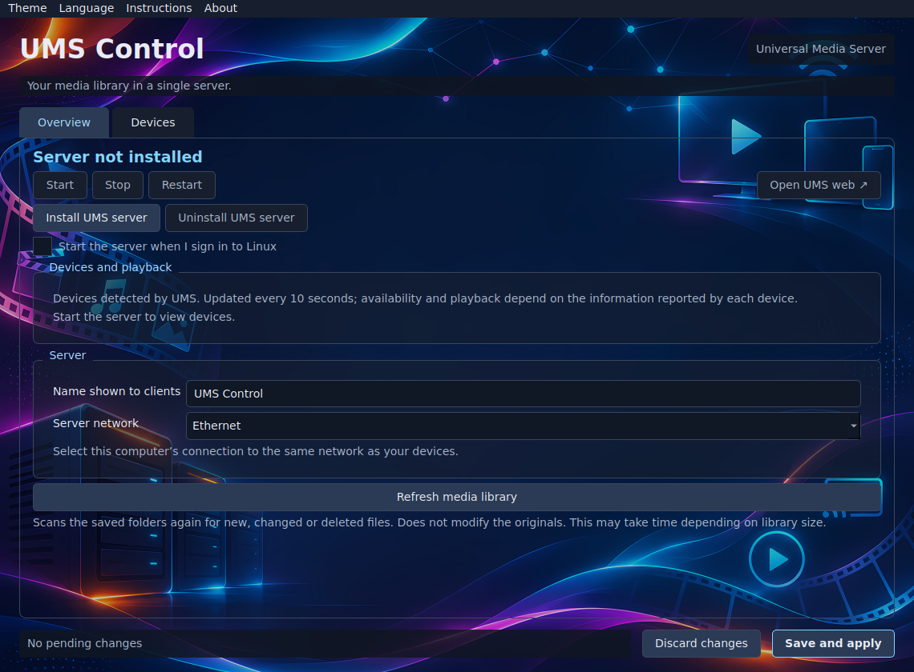
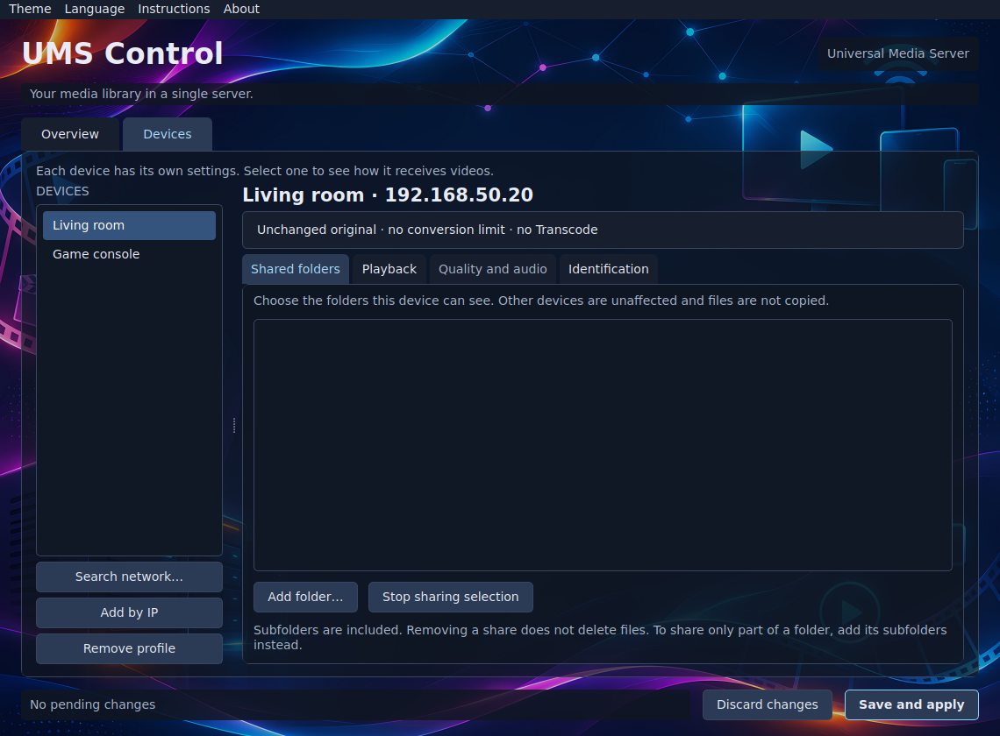
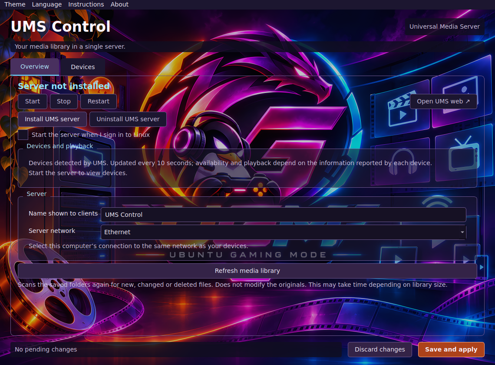
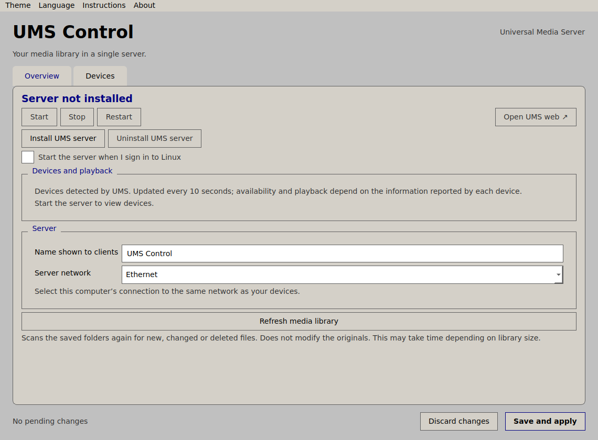
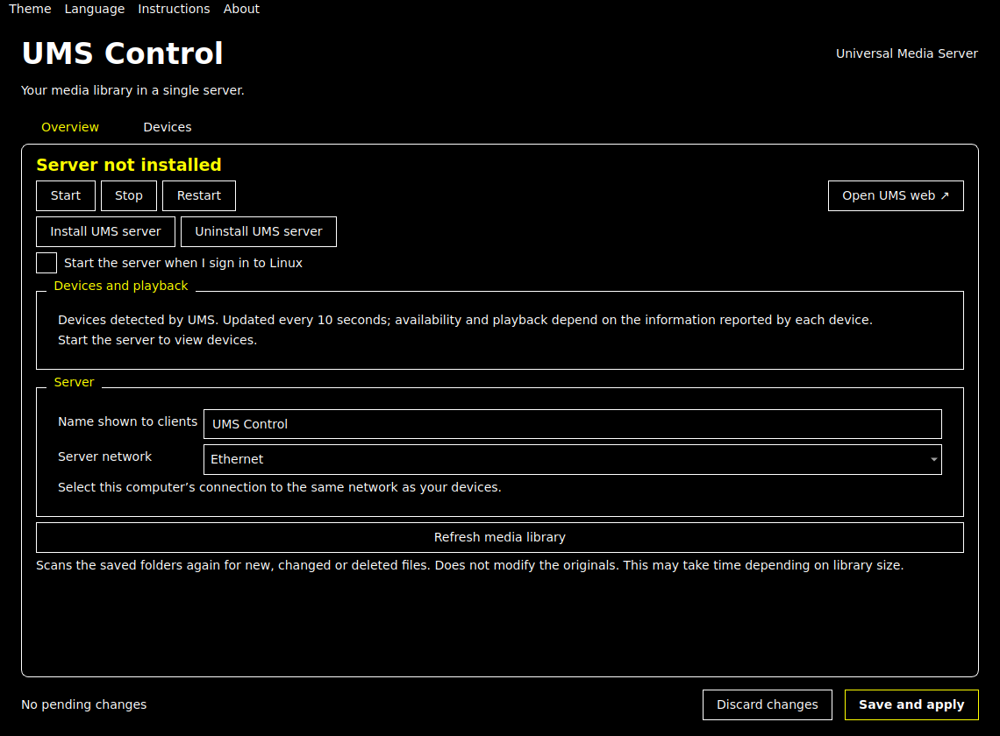
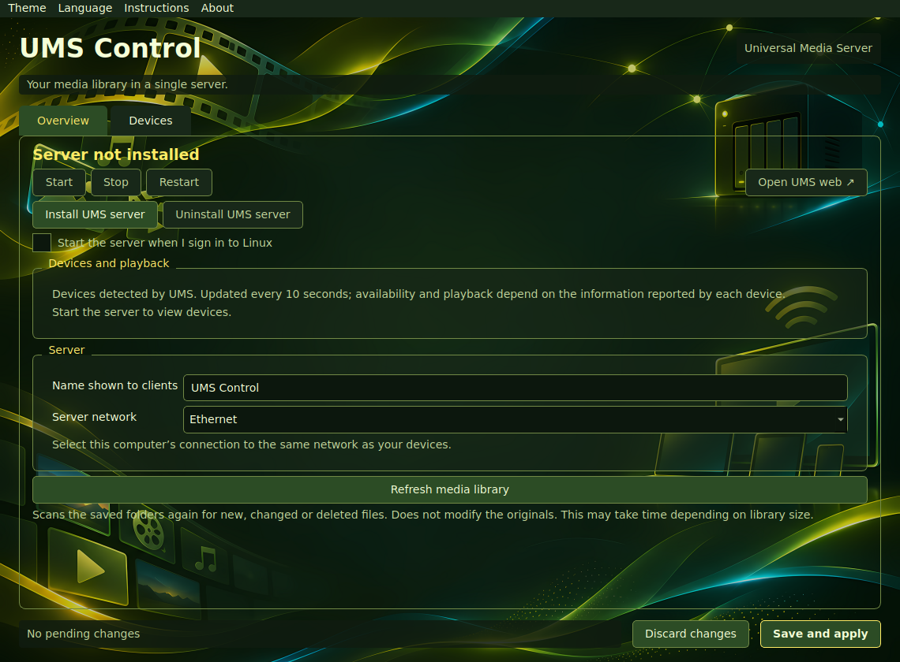
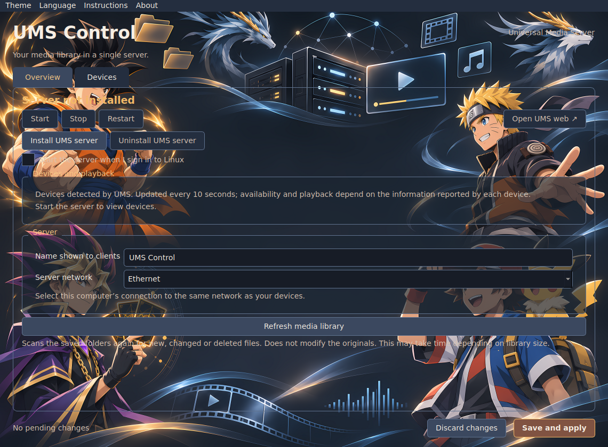
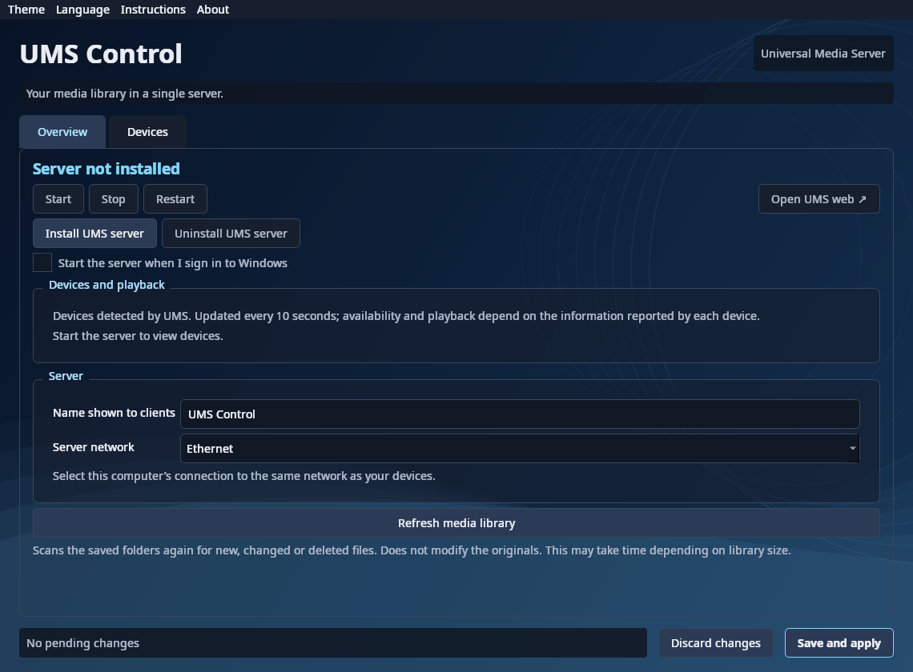
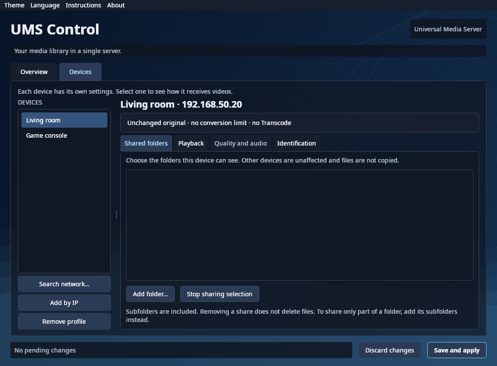

# UMS Control

[Español](README_ES.md)

Independent desktop control panel by **N3ruk** for Universal Media Server. Configure separate shared folders and playback settings for each DLNA device. This is not an official Universal Media Server product.

## Downloads and installation

Linux **1.0.0** is the [first release](https://github.com/N3ruk/UMS-Control/releases/tag/v1.0.0) (DEB and ZIP). The Windows EXE is distributed separately as [**v1.0.0-windows-rc1 — prerelease, native testing pending**](https://github.com/N3ruk/UMS-Control/releases/tag/v1.0.0-windows-rc1), not as part of the stable Linux release.

| System | Distribution | Installation |
| --- | --- | --- |
| Debian-family Linux, x86-64 | `.deb` | `sudo apt install ./ums-control_1.0.0-1_amd64.deb` |
| Other glibc Linux desktops, x86-64 | `.zip` | Extract, open a terminal in the extracted folder and run `./install.sh` as the desktop user |
| Windows 10/11, x86-64 — testing prerelease | `.exe` | Run `ums-control-1.0.0-windows-x86_64-setup.exe`; installation is per user |

The installers ask **in English** which language should be used for the first launch. Seven languages are available: English, Spanish, French, German, Italian, Chinese and Japanese. The language can be changed later from the **Language** menu. Existing user preferences take precedence.

The Linux packages include Python and Qt; no system Python, pip or compiler is needed. The ZIP does not use APT/RPM and does not need administrator privileges. Its compatibility target is **x86-64, glibc 2.35+**, an X11/Wayland desktop and standard graphics drivers. It is not a musl/Alpine or ARM package. See the [tested compatibility and limitations](docs/COMPATIBILITY.md); a portable format is not a guarantee for every distribution.

After opening **UMS Control**, select **Install UMS server** in **Overview**, then **Start**. This separate, explicit action downloads the official UMS runtime, checks its SHA256, applies the matching integration and tests a disposable copy before activating it. Internet access and temporary disk space are needed. Installing the panel does not start the server or enable session autostart.

Windows uses the same Qt interface, profile rules and Java integration as Linux, with OS-specific process management, paths, recycling and session autostart. **Windows remains a testing prerelease.** Native Windows 11 tests uncovered defects in the public RC1; a private corrected development candidate passed installer/server lifecycle, Unicode paths and cross-machine synthetic DLNA checks. Those fixes are not yet in the downloadable EXE. Physical TV/console playback, real session login, clean-machine firewall interaction and other acceptance checks remain pending. See the [exact tested scope and remaining checklist](docs/WINDOWS-TESTING.md).

## Screenshots

English interface with demonstration devices and no private library data. Linux images are real Qt renders of all six themes from the DEB payload in an isolated Linux userspace. Windows images show the packaged Windows executable running under Wine, not a native Windows desktop certification.

### Linux · DEB

#### Linux themes

### Windows · EXE

## Features

- Separate folders per device; unconfigured clients receive no content. Nested inclusion/exclusion and compatible announced names never rename source files.
- Original delivery, manual conversion and automatic delivery. Container, audio/subtitles, encoder, resolution and bitrate controls are shared across platforms.
- Resolution changes suggest an editable bitrate: 480p 5, 720p 10, 1080p 25, 1440p 40 and 2160p 60 Mbps. Saved manual values are preserved when opening/switching profiles.
- Overview: start/stop/restart, health/logs, install/repair/update/remove server, session autostart and catalogue refresh. Updates are explicit.
- Seven languages and six themes: Blue, UGM, Classic Windows, High contrast, Green/yellow and Anime. Linux includes the supplied icon and wallpapers; Windows uses its own geometric artwork. A built-in Instructions guide is included; private logs and settings are excluded.
- Saving and applying playback settings restarts an active server and interrupts playback. A stopped server stays stopped. Appearance preferences never apply server settings.

Some devices may not be **100% compatible**. Compatibility depends on the device, firmware and media formats, not simply on its manufacturer. No universal playback guarantee is made.

## Documentation

- [Usage and installation](docs/USAGE.md)
- [Compatibility and verification limits](docs/COMPATIBILITY.md)
- [Build and verification](docs/BUILD.md)
- [Third-party licenses and corresponding sources](THIRD_PARTY_NOTICES.md)
- [Verification results](docs/VERIFICATION.md)

## Data and independence

The program does not mount drives, configure Samba or modify original media. Removing shares/profiles does not delete files. Server removal keeps configuration and recycles only managed binaries. Damaged configuration requires an explicit recovery decision and is preserved before recovery.

Linux preferences and profiles retain the historical identifiers under `~/.config/baul-media-control`, `~/.config/baul-ums` and `~/.local/share/baul-ums`. Windows stores these under `%LOCALAPPDATA%\UMS Control`. Linux uses a systemd user service where available, otherwise a tracked per-user process; Windows uses a tracked per-user process. Autostart is a user choice, not a system service installed with administrator rights.

Administration is localhost-only (default 9001); DLNA uses the selected local IPv4 interface (default 5001). IP/UUID identification is not cryptographic authentication: use a trusted LAN. Windows firewall permissions depend on the selected private network and the operating system; the installer does not silently alter firewall rules.

Frontend/original artwork: **GPL-3.0-or-later**, Copyright (C) 2026 N3ruk. Java overrides retain upstream **GPL-2.0** notices and source in `patches/`. The official UMS JAR is never edited. See [LICENSE](LICENSE) and [third-party notices](THIRD_PARTY_NOTICES.md).
