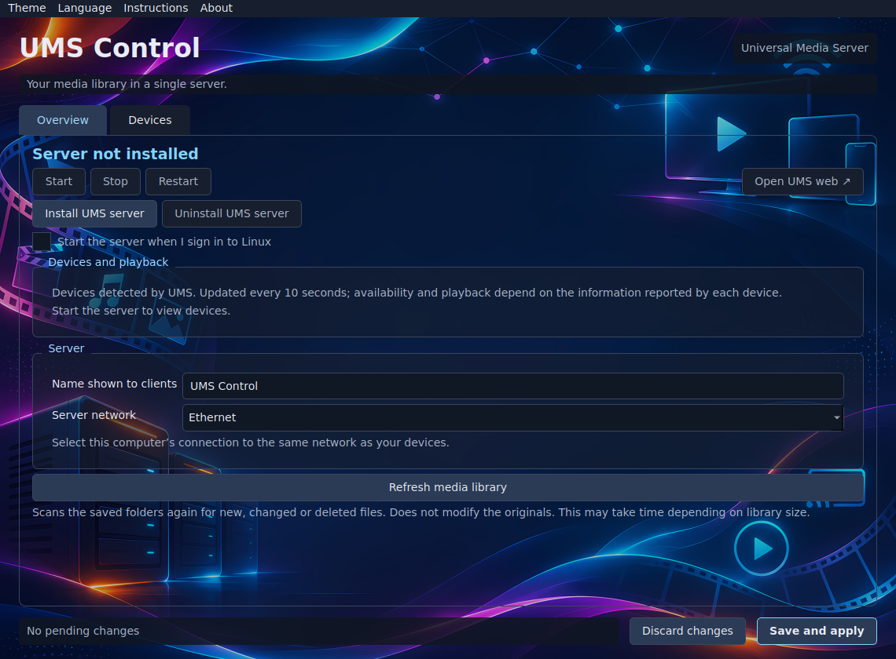
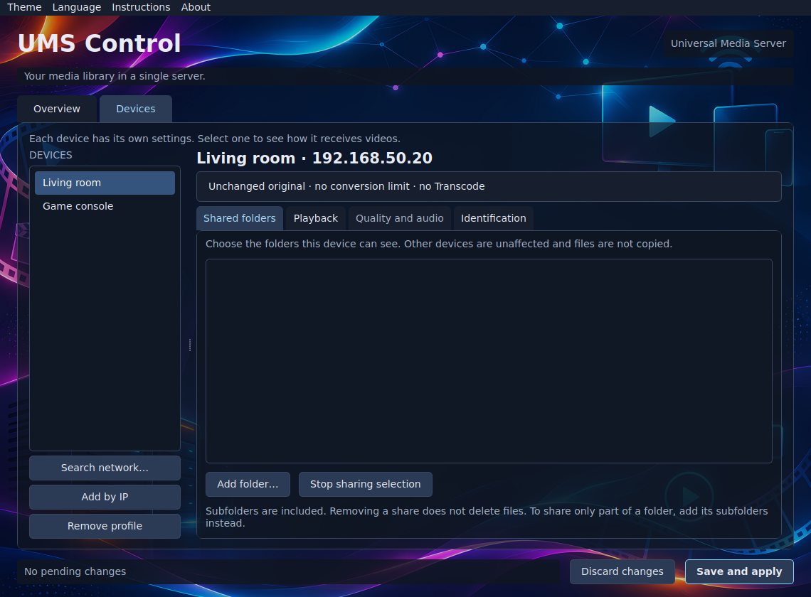
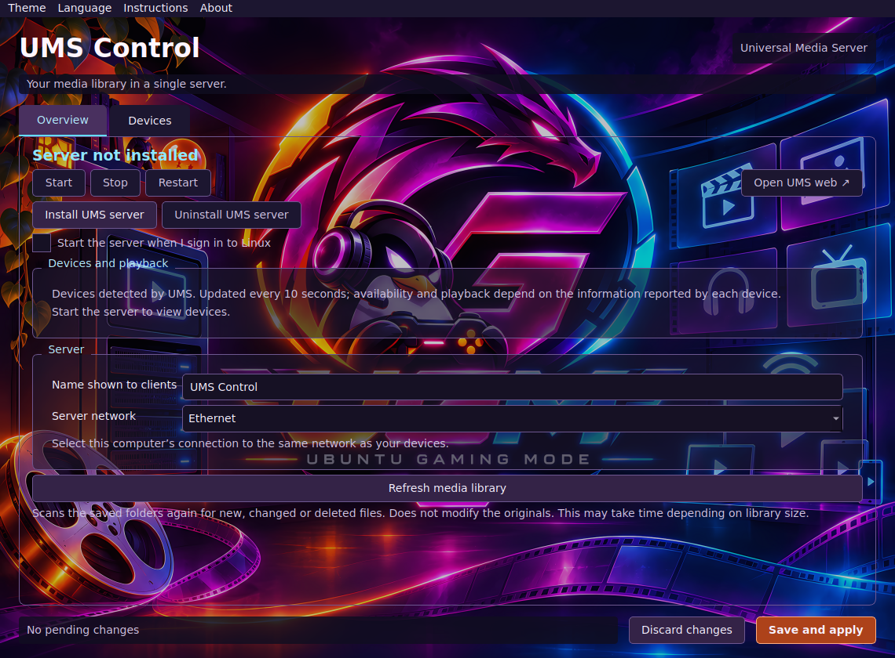
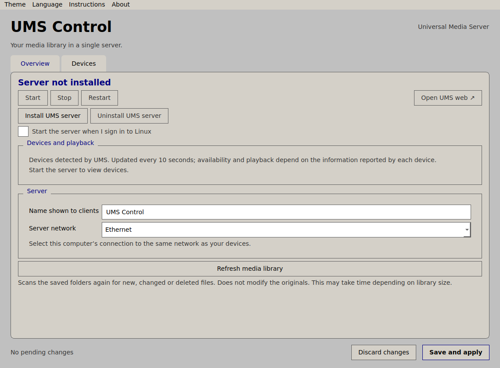
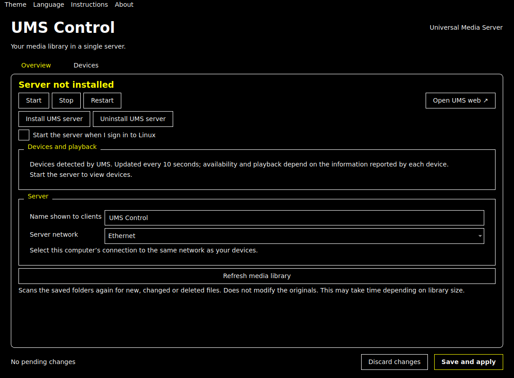
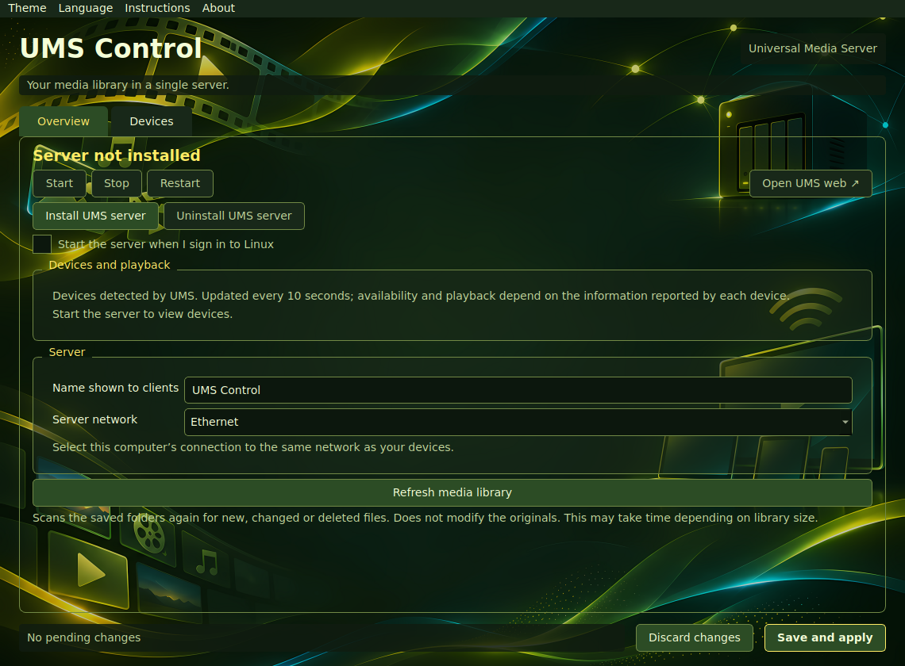
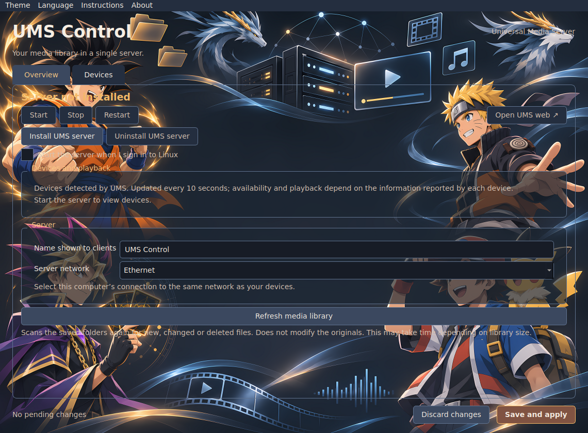
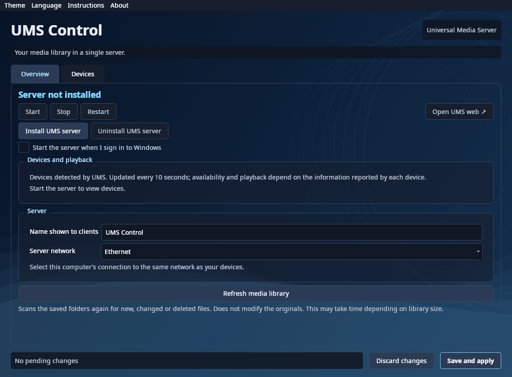
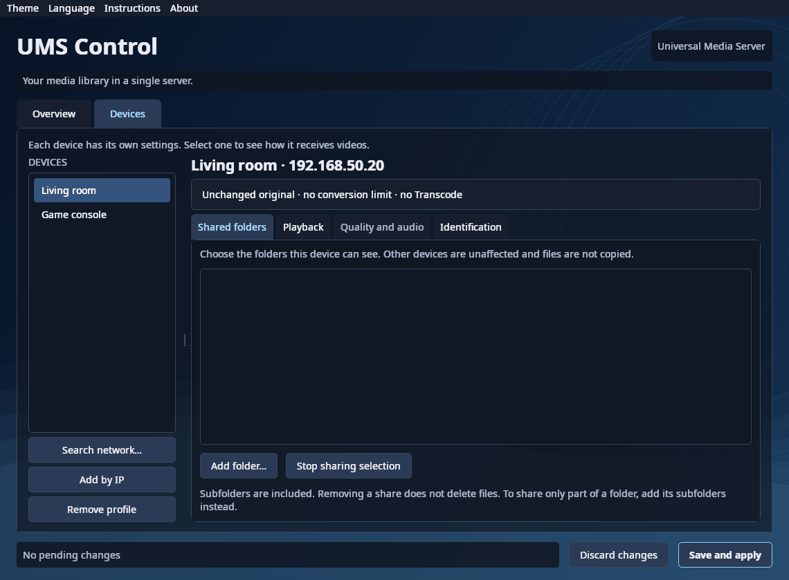

# UMS Control

[English](README.md)

Panel de escritorio independiente de **N3ruk** para Universal Media Server. Permite configurar carpetas y ajustes de reproducción distintos para cada dispositivo DLNA. No es un producto oficial de Universal Media Server.

## Descargas e instalación

Linux **1.0.0** es la [primera release](https://github.com/N3ruk/UMS-Control/releases/tag/v1.0.0) (DEB y ZIP). El EXE Windows se distribuye por separado como [**v1.0.0-windows-rc1 — prerelease, pruebas nativas pendientes**](https://github.com/N3ruk/UMS-Control/releases/tag/v1.0.0-windows-rc1), no dentro de la release estable de Linux.

| Sistema | Distribución | Instalación |
| --- | --- | --- |
| Linux de la familia Debian, x86-64 | `.deb` | `sudo apt install ./ums-control_1.0.0-1_amd64.deb` |
| Otros escritorios Linux con glibc, x86-64 | `.zip` | Extraer, abrir una terminal en la carpeta y ejecutar `./install.sh` como usuario del escritorio |
| Windows 10/11, x86-64 — prerelease de pruebas | `.exe` | Ejecutar `ums-control-1.0.0-windows-x86_64-setup.exe`; instalación por usuario |

Los instaladores preguntan **en inglés** el idioma del primer inicio. Se ofrecen español, inglés, francés, alemán, italiano, chino y japonés. Posteriormente puede cambiarse desde el menú **Idioma**. Las preferencias existentes se conservan.

Los paquetes Linux incluyen Python y Qt; no requieren Python del sistema, pip ni compilador. El ZIP no utiliza APT/RPM ni requiere privilegios de administrador. Su objetivo de compatibilidad es **x86-64, glibc 2.35+**, escritorio X11/Wayland y controladores gráficos normales. No es un paquete para musl/Alpine ni ARM. Véanse los [sistemas probados y sus límites](docs/es/COMPATIBILIDAD.md); el formato portable no garantiza todas las distribuciones.

Tras abrir **UMS Control**, seleccionar **Instalar servidor UMS** en la pestaña **Resumen** y después **Iniciar**. Esta acción independiente y explícita descarga el runtime oficial de UMS, verifica su SHA256, incorpora la integración correspondiente y prueba una copia temporal antes de activarla. Requiere conexión a Internet y espacio temporal. Instalar el panel no inicia el servidor ni activa el autoinicio.

Windows utiliza la misma interfaz Qt, reglas por dispositivo e integración Java que Linux. Se adaptan la gestión de procesos, rutas, papelera e inicio de sesión. **La aceptación en Windows nativo sigue pendiente**: el ejecutable y el instalador han superado las comprobaciones del instalador y del ejecutable bajo Wine, lo que no certifica la red, los avisos del cortafuegos ni la reproducción física en Windows.

**Windows aún no está validado en Windows 10/11 nativo.** Falta probar instalación/reparación/actualización real del servidor, inicio/parada/reinicio, autoinicio, búsqueda en LAN y cortafuegos, y navegación/reproducción DLNA física (original y convertida, audio/subtítulos y saltos). También falta confirmar instalador/reinstalación/retirada y conservación de ajustes en Windows nativo. Véase la [lista completa pendiente](docs/es/PRUEBAS-WINDOWS.md); Windows solo se añadirá a una release estable tras superar esas pruebas.

## Capturas

Interfaz inglesa y dispositivos de demostración, sin datos de bibliotecas privadas. Las imágenes Linux son renderizados Qt reales del contenido del DEB en un entorno Linux aislado. Las imágenes Windows muestran el ejecutable empaquetado bajo Wine; no representan una certificación de escritorio Windows nativo.

### Linux · DEB

#### Temas Linux

### Windows · EXE

## Funciones

- Carpetas independientes por dispositivo; los clientes sin configurar no reciben contenido. Inclusiones/exclusiones anidadas y nombres anunciados compatibles sin renombrar originales.
- Entrega Original, conversión manual y automática. Mismos controles de contenedor, audio/subtítulos, codificador, resolución y bitrate en ambas plataformas.
- Bitrate recomendado editable al cambiar resolución: 480p 5, 720p 10, 1080p 25, 1440p 40 y 2160p 60 Mbps. Abrir o cambiar de perfil conserva los valores manuales guardados.
- Resumen: inicio/parada/reinicio, salud/registro, instalación/reparación/actualización/retirada del servidor, autoinicio de sesión y actualización del catálogo. Actualizaciones siempre explícitas.
- Siete idiomas y seis temas: Azul, UGM, Windows clásico, Alto contraste, Verde/amarillo y Anime. Linux incluye el icono y los fondos proporcionados; Windows utiliza su propio arte geométrico. Guía de Instrucciones incluida; ajustes y diagnósticos privados excluidos.
- Guardar y aplicar reinicia un servidor activo e interrumpe la reproducción. Un servidor detenido permanece detenido. Las preferencias visuales no aplican ajustes del servidor.

Algunos dispositivos pueden no ser **compatibles al 100 %**. La compatibilidad depende del dispositivo, su firmware y los formatos multimedia, no simplemente del fabricante. No se garantiza la reproducción universal.

## Documentación

- [Uso e instalación](docs/es/USO.md)
- [Compatibilidad y límites de verificación](docs/es/COMPATIBILIDAD.md)
- [Construcción y verificación](docs/es/CONSTRUCCION.md)
- [Licencias y fuentes de terceros](THIRD_PARTY_NOTICES.md)
- [Resultados de verificación](docs/es/VERIFICACION.md)

## Datos e independencia

La aplicación no monta unidades, configura Samba ni modifica medios originales. Retirar carpetas o perfiles no borra archivos. La retirada del servidor conserva la configuración y envía a la papelera únicamente los binarios gestionados. La recuperación de ajustes dañados requiere una decisión explícita y conserva antes el original.

En Linux se conservan los identificadores históricos de `~/.config/baul-media-control`, `~/.config/baul-ums` y `~/.local/share/baul-ums`. Windows utiliza `%LOCALAPPDATA%\UMS Control`. Linux utiliza un servicio systemd de usuario cuando está disponible y, en otro caso, un proceso gestionado por usuario. Windows utiliza un proceso gestionado por usuario. El autoinicio es una elección del usuario; no se instala un servicio de sistema con derechos de administrador.

La administración se limita a localhost (9001 por defecto); DLNA utiliza la interfaz IPv4 local seleccionada (5001 por defecto). La identificación IP/UUID no es autenticación criptográfica: utilizar una LAN de confianza. Los permisos del cortafuegos Windows dependen de la red privada seleccionada y del sistema; el instalador no altera sus reglas silenciosamente.

Interfaz y arte original: **GPL-3.0-or-later**, Copyright (C) 2026 N3ruk. Los cambios Java conservan los avisos upstream **GPL-2.0** y sus fuentes en `patches/`. No se modifica el JAR oficial de UMS. Véanse [LICENSE](LICENSE) y [avisos de terceros](THIRD_PARTY_NOTICES.md).
